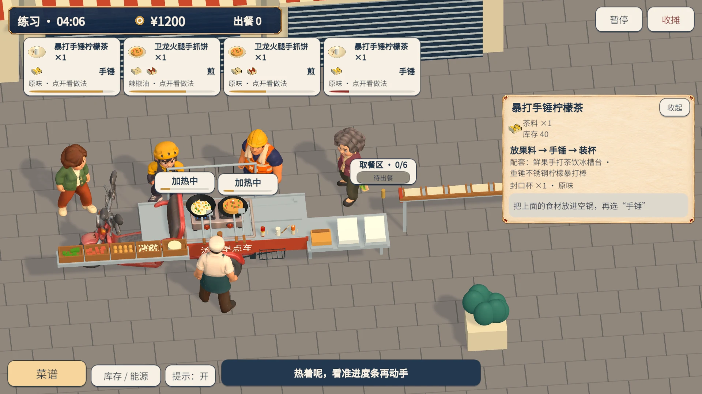

# 摆摊模拟器：国潮来袭

一款以街头小吃摊为主题的 2.5D 模拟经营游戏，使用 Unity 开发。你可以准备家当、自由采购、选择摊位，再把手中的食材变成今天要卖的东西。

[在线游戏](https://www.kw-aigc.cn/demos/guochao/) · [项目报告](docs/PROJECT-REPORT.md) · [源代码](https://github.com/KevinYoung-Kw/guochao-stall-simulator)

*当前版本的经营场景实机截图。*

## 这一版可以怎么玩

- 按自己的需要采购。同一种货可以分批购买，结账可以只选篮子中的一部分。
- 菜谱和采购计划提供参考；手头已有的食材，也可以自由组合烹饪。
- 成品装好后，可以拿在手中递给顾客，也可以放到取餐台，让顾客走来取餐。
- 看顾客的做法卡，查看口味、包材和制作步骤；备餐过程中可以继续处理其他事情。
- 从家中整备到市场、摊位经营，再到结算和保存，接着经营下一天。

## 基本操作

| 操作 | 按键 / 方法 |
|---|---|
| 走动 | WASD |
| 空手跑步 | Shift |
| 场景交互 | E |
| 接上 / 放开推车 | F |
| 推车前进 / 倒退 | W / S |
| 推车转向 | A / D |
| 营业时选食材、设备和顾客 | 鼠标 |
| 暂停 | Esc |
| 音乐 / 音效音量 | 暂停菜单中的“音乐”和“音效”按钮 |

营业时可以先做菜，再决定卖给谁。把餐放在取餐台后，再点这份餐和要取餐的顾客；顾客走来取餐时，摊主可以继续备菜。

## 本地运行

1. 安装 Unity **6000.6.7f1**；构建网页版时，同时安装 Web Build Support。
2. 用 Unity Hub 打开仓库根目录，等待资源导入。
3. 打开 `Assets/Scenes/Playable.unity`，点击 Play。
4. 导出网页时选择 Web 平台和 `Guochao` 网页模板。构建产物需要通过 HTTP(S) 访问。

仓库保留 `Assets`、`Packages` 和 `ProjectSettings`。Unity 运行环境、导入缓存、用户存档、生成服务凭据和内部协作记录不随源码分发。运行游戏不需要 Aholo API Key；三维生成结果已经导入项目。

## 美术与制作

角色、三轮车、部分设备和场景物件来自 Aholo 三维生成流程，随后完成转换、减面、材质、绑定及场景装配。大环境、部分家居、UI 和仍在迭代的道具包含项目自制内容。脚步、车轮和放置物品的音效由代码合成。

当前仍在完善调料、餐具、菜品成品和升级车的独立美术，以及更多顾客动作和事件。已有生成模型不等于所有规划内容都已完成。

## 许可

项目原创代码以 **Apache License 2.0** 开源。模型、贴图、字体和 Unity 依赖的许可范围另见 [ASSET-NOTICE.md](ASSET-NOTICE.md)；代码许可不覆盖这些独立资产。
