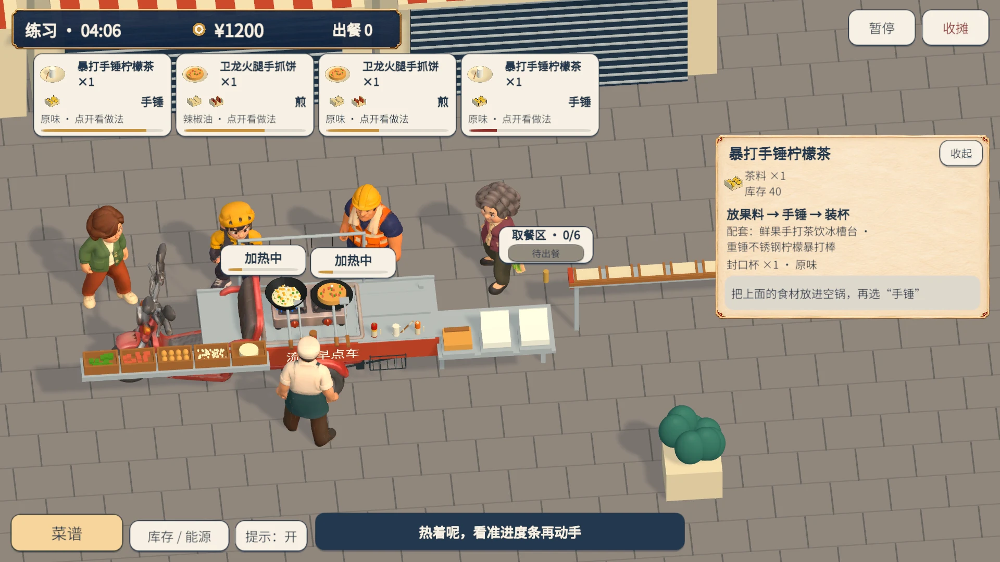

# 摆摊模拟器：国潮来袭｜项目报告

**用手头的食材，经营自己的街头小吃摊。** 项目采用 Unity 制作，以 2.5D 视角呈现出租屋整备、市场采购与摊位经营。玩家可以参考菜谱备货，也可以根据已有食材和设备自由制作，完成加工、调味、装餐和售卖。

[在线体验](https://www.kw-aigc.cn/demos/guochao/) · [GitHub 源代码](https://github.com/KevinYoung-Kw/guochao-stall-simulator)

## 当前实机效果

*Unity 实机经营界面，展示顾客订单、操作台与取餐区。图中界面和场景来自运行版本，不是效果概念图。*

## Aholo 参与了哪些制作环节

项目已核对 **19 个独立 Aholo 生成模型来源，其中 16 个模型族已有运行资源并接入相应场景**。角色动作、减面版本和重复导出没有重复计数。主要内容包括：

| 类别 | 已接入内容 |
|---|---|
| 经营主角与交通工具 | 摊主、摆摊三轮车 |
| 顾客 | 社区女顾客、外卖骑手、工人、卷发阿姨、女大学生 |
| 市场角色 | 收银员、回收站小摊贩、摊贩伯爵 |
| 场景与设备 | 猛火炉、出租屋木床、果蔬花车、沿街店面 |
| 商品 | 速冻饭包装、料理包包装 |

生成结果随后经过运行格式转换、减面、材质配置和场景装配；活动角色还需要绑定和动作。游戏运行时直接加载已导入的资源，无需玩家配置生成服务。各模型的来源见仓库 [资产清单](https://github.com/KevinYoung-Kw/guochao-stall-simulator/blob/main/ASSET-NOTICE.md)。

## 从生成模型到可玩的交互

制作中最重要的迭代，是让模型、操作位置和经营结果对应起来。工人初版未能完成绑定，后来改用 T 姿版本再接入；旧版与新版没有算作两个已完成角色。

出餐流程也从单一交付改成两条路径：**装好的餐可以拿在手里直接递给顾客，也可以先放入取餐区，再指定顾客走来取。** 顾客取餐期间，摊主可以继续备菜。成品、包材和收款按实际交接处理；取消取餐或保存时，尚未交出的餐继续保留。

不同体型的顾客需要不同的接餐姿势。当前接餐动作会选择合适站位和侧身角度，配合身体前探与脚步约束；大体型顾客另做了独立实机场景验证。界面同时补充做法卡，把食材、库存、口味、工具和包材信息放在玩家能直接查看的位置。

## 当前完成度

v20 已完成直接递餐、顾客自取与并行备菜、取消后保留餐食、手持成品保存恢复，以及大体型顾客取餐的五项实机场景验收；这些是有明确起始条件的场景测试，不代表整局人工体验已经全部验收。

项目仍在迭代车辆升级、更多菜品的独立美术、角色动作与经营事件。调料、餐具和部分场景使用自制或程序模型；本轮补接的搪瓷盆、榆木凳等家居来自 Blender 制作，不计入 Aholo 的 16 个运行模型族。
